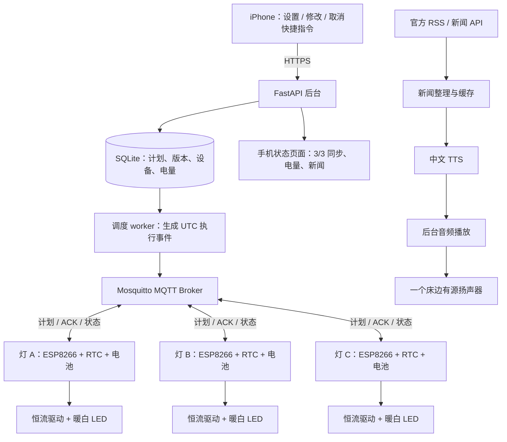
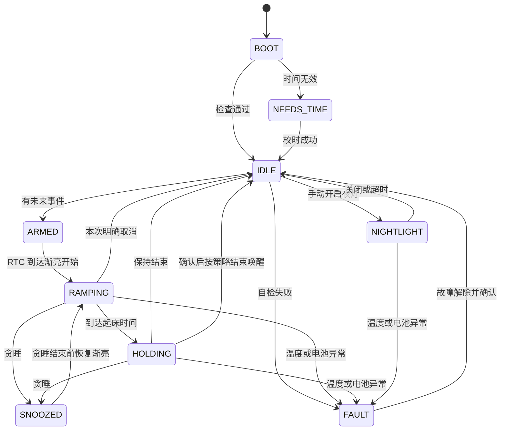

# 三盏便携暖光唤醒灯：iPhone、独立电池与中文晨间新闻

版本：v2，2026-10-22  
项目：`E:\Code\SMART_LAMP`  
状态：完整开发设计文档；尚未制作、烧录或完成整机实测。

软件进展（2026-10-22）：已增加面向一块 ESP8266 与测试 LED 的软件 MVP。当前运行入口见 [README](README.md)，范围与最终产品的差异见 [软件 MVP 要求](docs/SOFTWARE_MVP.zh-CN.md)，实际验证结果见 [验证记录](docs/VERIFICATION.zh-CN.md)。本文下方仍描述最终产品目标，不代表所有功能已经实现。

本版按照已经确认的需求，替换此前“一个控制盒连接三个有线灯头”的设计。采购、接线和功耗以本版为准。

## 1. 已确认的产品需求

| 项目 | 已确认选择 |
| --- | --- |
| 手机 | iPhone |
| 设置方式 | 接受通过一个“设置唤醒灯”快捷指令统一设置起床时间 |
| 灯数量 | 3 盏，相互没有供电线，各自带电池和 Wi-Fi 控制器 |
| 外形 | 可手拿、可爱、温馨，接近小动物 / 小夜灯的感觉 |
| 光 | 暖白光、足够亮，三灯联动渐亮来唤醒 |
| 新闻 | 一个床边扬声器朗读中文新闻 |
| 充电频率 | 目标一周充一次；可以接受较大的灯体 |
| 控制芯片 | 每灯一个 ESP8266，合计 3 个 |

推荐架构：**三盏独立电池灯 + 一台常开新闻/调度主机 + 一个插电床边扬声器**。三灯通过 Wi-Fi 共享同一个起床计划，各自在本地按时间渐亮。

### 1.1 用户会怎样使用

1. 晚上在 iPhone 点“设置唤醒灯”，选择明早 07:00。
2. 快捷指令把时间发给后台；后台向三灯下发计划。
3. 界面显示“3/3 已保存，06:40 开始渐亮”，并显示各灯电量。
4. 到时间后三灯自行渐亮，iPhone 不必保持运行，后台临时离线也不影响已保存的灯光计划。
5. 07:05 由一个床边扬声器自动朗读当天中文简报；时间可调，也可改成按“已起床”才播放。
6. 白天可以单独拿起某盏灯使用低亮夜灯模式。
7. 约每周集中充电一次，是否达到一周以第 5 节的使用条件与实测为准。

自动新闻播报发生在光唤醒之后；如果睡得很沉，新闻声音仍可能叫醒人。若要求整个起床过程始终只依靠灯光，选择“确认起床后播报”。

### 1.2 当前明确的能力边界

- iPhone 快捷指令是本项目唤醒时间的统一入口；在原生时钟里另行改时间，不自动等价于改了三灯计划。Apple 的闹钟自动化事件不能直接当成所有闹钟编辑动作的通知。[Apple 闹钟事件说明](https://support.apple.com/en-au/guide/shortcuts/apd932ff833f/ios)
- 一周充一次是工程目标，依赖待机电流、实际电池容量和每天亮多久，尚未验证。
- 电池灯能脱离底座使用；后台和新闻扬声器可以插电，不计入灯的电池续航。
- 可以手拿、摆在床边；照明时避免被寝具覆盖，充电放在硬质通风台面。软胶外壳仍需散热、挤压和滚落测试。
- 实际光唤醒效果需要在真实床位试用，不能用瓦数保证每个人都会醒。

## 2. 外形、尺寸与灯光设计

### 2.1 外形方向

优先选择“**圆润小动物扩散罩 + 稳固底座**”，例如小熊、小猫、圆团子。外观可以统一，也可以三只不同角色。

| 部位 | 设计要求 |
| --- | --- |
| 发光外壳 | 乳白扩散 PC，或有材料资料的硅胶扩散罩；表面柔和，无可直视灯珠 |
| 底座 | PC/ABS 硬质结构，容纳电池与电路，防滑且不容易滚动 |
| LED | 安装在铝基板和散热结构上，位于发光罩下方 |
| 电池 | 固定在底座独立区域，与 LED、充电芯片保持热隔离 |
| 按键 | 底部或背面大按钮，低亮操作也容易找到 |
| 充电口 | 每灯独立 USB 充电口，带应力释放和防误插 |
| 无线 | ESP8266 天线区域远离电池金属外壳、大面积铜和散热金属 |
| 维修 | 螺钉连接，电池由连接器接入，不靠破坏外壳才能更换 |

初步尺寸包络：每灯底座约 100–120 mm，整体高度约 130–180 mm；重量目标约 300–500 g。**这些是设计目标，不是已经完成的 CAD 尺寸。** 最终根据采购电池包、散热和防倾倒测试确定。

10,000 mAh 电池需要占用空间，因此成品会比迷你钥匙扣夜灯大。先用纸板或 3D 打印件验证握持与摆位，再做可爱外壳。

### 2.2 光学参数

| 参数 | 初始设计目标 |
| --- | --- |
| 色温 | 单色暖白 2700–3000 K |
| 峰值 LED 电功率 | 每灯约 3 W，三灯约 9 W |
| 成品输出光通量 | 每灯约 150–250 lm，三灯约 450–750 lm，待实测 |
| 显色 | 目标 CRI ≥90，需以实际 LED SKU 资料确认 |
| 默认渐亮 | 20 分钟 |
| 默认峰值保持 | 20 分钟 |
| 普通夜灯模式 | 约 0.2 W LED，默认 30 分钟自动熄灭 |
| 调光 | 每灯可单独校准，组内共用时间曲线 |

每灯先按三颗约 1 W 的暖白 LED 串联、约 300 mA 恒流设计，合计正向电压约 9–10 V；具体电压与额定电流必须按所购 LED 资料重新核算。也可以采购已经装好铝基板的等效串联 LED 模组。

光通量是经过外壳后的目标，不能把灯珠标称流明直接当成成品流明。真实床位可以先把眼睛附近垂直照度约 100–300 lx 作为可调试验范围，再根据距离和试用调整。它不代表医疗标准。

### 2.3 摆位

三灯放在床头左侧、右侧和靠近头部的稳定位置，发光面朝向需要照亮的区域。若全部放在远处或被身体挡住，即使三灯全亮也可能不够。

充电时移到床头柜等硬质台面。若最终必须长期直接放床垫上使用，需要在最终软壳与寝具接触条件下完成温升、防滚落和受压验证，再确定允许的使用方式。

## 3. 总体软件与硬件架构



三灯各自具有电池、充电管理、稳压、恒流驱动、时钟和温度检测，数量不能继续沿用旧版的“一个 ESP8266”。

### 3.1 常开主机

优先复用现有树莓派或 Linux 小主机；没有的话选 Raspberry Pi 4B / 2 GB 及以上。

主机负责手机 API、三灯计划分发、数据库、新闻抓取、语音合成与播放；ESP8266 不承担新闻抓取和音频解码。音箱可使用 USB 数字音频，或主机适配的音频输出。

如果扬声器与后台主机相距较远，可以采用合适的音频线或独立网络播放端；初版把主机与扬声器放在床头柜附近最直接。

### 3.2 三灯同步原则

后台提前发送相同的 `occurrence_id`、`ramp_start` 和 `wake_at`；三灯按照各自 RTC 执行，不能靠三条“现在开灯”命令的网络到达顺序来同步。

三灯之间启动偏差目标 ≤1 秒；相对起床计划的误差目标 ≤5 秒。这些目标要通过联网校时、RTC 和真实硬件测试验证。可以单独设置灯 A/B/C 的亮度补偿。

## 4. iPhone 快捷指令：最终采用的接入方式

### 4.1 提供三个快捷指令

| 名称 | 行为 |
| --- | --- |
| 设置唤醒灯 | 选择日期时间，设置渐亮与新闻时间，保存到三灯 |
| 修改 / 取消唤醒灯 | 修改同一个后台计划，或取消下一次 / 关闭重复规则 |
| 查看我的灯 | 显示三灯电量、下一次起床时间、保存状态与故障 |

初版不必开发原生 iOS App。Apple 官方支持用“获取 URL 内容”动作发送 API 请求，可选择请求方法并提交 JSON。[Apple 快捷指令 API 请求指南](https://support.apple.com/guide/shortcuts/request-your-first-api-apd58d46713f/ios)

### 4.2 “设置唤醒灯”的动作顺序

1. 询问日期与时间；可选“仅明天”或预设的每周规则。
2. 获取用户配置的时区，例如 `Asia/Bangkok`，生成带时区的时间。
3. 组装 JSON：起床时间、渐亮秒数、峰值、保持时间、新闻时间与请求 ID。
4. 通过 HTTPS 向后台提交，认证令牌放在请求头。
5. 后台先持久化，再下发三灯，返回计划 ID、版本、状态查询地址。
6. 快捷指令短暂查询确认状态：只有三灯都保存成功才显示“3/3 已保存”。
7. 有灯离线时显示“2/3 已保存，灯 C 待同步”，打开状态页；不要让快捷指令无限等待。
8. 修改、取消沿用同一个计划 ID，避免堆积多个明早闹钟。

快捷指令只在设置时运行，不需要整夜执行、长时间 Wait 或在起床时重新请求开灯。

原生时钟如果另设后备闹钟，其声音、振动和开关由用户明确配置；本项目的“无铃声”指三灯唤醒流程不主动播放铃声，不能自动保证手机原生闹钟也静音。

### 4.3 示例请求

```json
{
  "request_id": "iphone-wake-20261022-a1",
  "group_id": "bedroom",
  "wake_at": "2026-10-23T07:00:00+07:00",
  "timezone": "Asia/Bangkok",
  "ramp_seconds": 1200,
  "hold_seconds": 1200,
  "peak_percent": 100,
  "news": {
    "enabled": true,
    "language": "zh-CN",
    "play_at": "2026-10-23T07:05:00+07:00",
    "mode": "scheduled"
  }
}
```

重复闹钟另存当地时间、星期和 IANA 时区，由后台编译为具体日期的 UTC 事件。手机重发同一个请求 ID 不能生成两次唤醒。

### 4.4 网络条件

第一版在家中同一网络设置。需要在外面设置时，用 VPN 回家或另做安全中继；未实现前不承诺蜂窝网络远程同步。

手机必须信任后台 HTTPS 证书。需要在目标 iPhone 验证首次网络访问、证书、锁屏及快捷指令权限。数据库保存成功与三灯保存成功是两个不同状态。

## 5. 一周续航计算与省电方案

### 5.1 推荐电池规格

**每灯一个成品 1S、标称 3.6/3.7 V、约 10,000 mAh 的受保护锂离子电池组，三灯共三个电池组。**

采购要求：适配 4.2 V 充电终止电压、带过充/过放/过流保护，持续放电能力至少约 2 A，允许所设充电电流，提供容量、尺寸、温度范围、保护与 NTC 资料。可采用厂家装配的 1S2P 21700 电池组，最终以供应商正式资料为准。

这是容量与接口的采购目标，尚未锁定具体 10,000 mAh SKU。不要自行把来历不同的电芯并联、焊接成组，也不要把“10,000 mAh 充电宝”直接当成已验证的内部电源：它可能在低负载时自动断电。

```text
每灯标称能量 = 3.7 V × 10 Ah = 37 Wh
保守可用能量预算 = 37 Wh × 70% = 25.9 Wh
```

70% 是为截止电压、容量偏差、老化等预留的工程系数，不是电池厂家已保证的可用比例。LED 驱动效率在下面单独计算。

### 5.2 默认每天使用情况

| 用电项 | 假设 | 电池侧能量预算 |
| --- | --- | --- |
| 渐亮 | 20 分钟，LED 峰值 3 W，按平均 50% 功率估算 | LED 输出侧 0.50 Wh |
| 峰值保持 | 20 分钟，LED 3 W | LED 输出侧 1.00 Wh |
| 手拿夜灯 | 30 分钟，LED 0.2 W | LED 输出侧 0.10 Wh |
| LED 转换损耗 | 按平均效率 85% 估算 | 上述合计 1.60 / 0.85 ≈ 1.88 Wh |
| 亮灯期间控制电路 | 合计约 70 分钟 | 0.40 Wh |
| 其余待机 | 约 22.83 小时，电池端平均总电流目标 ≤5 mA | 3.7 × 0.005 × 22.83 ≈ 0.42 Wh |
| 每天合计 | 每灯 | 约 2.70 Wh |
| 七天合计 | 每灯 | 约 18.9 Wh |

25.9 Wh 的保守可用预算大于 18.9 Wh 的七天预算，有约 7 Wh 余量。公式得到约 9.6 天只是模型结果；**产品目标仍为实测七天，不承诺 9.6 天续航**。

每盏灯的电池必须独立满足条件。三块电池容量相加不能用来证明其中一盏能亮一周。

### 5.3 使用习惯如何影响续航

| 情况 | 同一模型下的粗略续航 | 原因 |
| --- | --- | --- |
| 默认使用、待机达到目标 | 约 9.6 天模型值，验收目标 ≥7 天 | 留有容量与运行余量 |
| 0.2 W 夜灯整夜开 8 小时 | 约 3.8 天 | LED 耗电增加，软件 PWM 期间控制器也保持较高功耗 |
| 每天额外 3 W 全亮 2 小时 | 约 2.5 天 | 大幅增加照明与控制用电 |
| ESP8266 长期处于普通活跃联网状态 | 示例约 2.9 天 | 示例按 80 mA / 3.3 V 及 90% 转换效率估算；不是整机测量结果 |

这些情景都只是量级比较。实际续航还会随 Wi-Fi 信号、路由器、温度、电池与驱动效率变化。

### 5.4 固件省电策略

**主方案使用 Light-sleep 待机，亮灯时正常工作。**

- 灯关闭时关闭 LED 电源支路，停止 PWM 和高频定时任务。
- Wi-Fi 已连接时，使用自动 Light-sleep；验证实际路由器与固件版本下的连通性和电池端平均电流。
- 按键使用 GPIO12 等支持的低电平唤醒方式；按下后先退出睡眠，释放后再重新允许休眠。
- 网络不可达时停止频繁重连，退避后通过定时唤醒或按键再尝试；本地灯光调度继续。
- 休眠窗口必须在下一个本地渐亮事件之前结束；有计划时宁可提前唤醒，不能睡过起点。
- 电量和温度状态低频上报，不做每秒心跳。
- 移除正式版常亮指示灯、USB 转串口常供电等耗电源。
- GPIO 外部下拉保证休眠、复位时 LED 关闭；验证信号线不反向供电。

Espressif 资料给出特定条件下的芯片低功耗参数，也指出 Light-sleep、DTIM、任务间隔和 GPIO 唤醒条件之间的关系；**芯片数值不能直接当成整个灯的待机电流**。GPIO16 不作为 Light-sleep 唤醒按键。[Espressif 低功耗说明](https://documentation.espressif.com/9b-esp8266-low_power_solutions__en.html)

NodeMCU 可用于第一阶段学习与验证，正式电池版使用低功耗 ESP-12 模块载板/定制 PCB；不能默认带 USB 转串口和常亮 LED 的开发板也能达到 ≤5 mA 总待机。

### 5.5 充电时间

先按每灯 1 A 充电电流设计，约 10 Ah / 1 A = 10 小时的理想恒流量级，加上恒压、温度限制和边用边充，完整充电可按约 12–15 小时规划，实际以电池和充电器测试为准。

可以把三灯在某一天同时接充电器。若最终热设计只允许 0.5 A，充电时间会显著增加；不能为缩短时间而超过电池或模块允许值。

## 6. 每灯电源与 LED 电路

### 6.1 电源路径

```text
正规 5 V USB 电源
       │
USB 输入保护 / 合适输入限流
       │
BQ24074 充电与 Power Path 管理
       ├── BAT ── 受保护 1S 电池组
       │            ├── MAX17048：测电池电压 / 估算电量
       │            └── 电池 NTC：接充电器温度输入
       │
       └── OUT / SYS（随供电状态约 3–4.4 V，不是固定 5 V）
                    ├── 3.3 V 升降压 ── ESP8266 / RTC / 温度传感器
                    └── LED 支路保护 ── 负载开关
                                            │
                                      恒流升压 LED 驱动
                                            │
                                      暖白 LED 串联模组
```

选 Power Path 的原因是区分电池充电与系统负载，让系统在接 USB 时优先使用外部电源。BQ24074 是可参考方案，充电器的 OUT 不是 3.3 V 稳压口，不能直接接 ESP8266。[TI BQ24074](https://www.ti.com/product/BQ24074)、[Adafruit 参考模块引脚](https://learn.adafruit.com/adafruit-bq24074-universal-usb-dc-solar-charger-breakout/pinouts)

### 6.2 关键器件

| 功能 | 参考选型 | 需要验证 |
| --- | --- | --- |
| 充电与 Power Path | BQ24074；现成参考板 Adafruit 4755 | 输入限流、1 A 充电、NTC、板温、负载分配 |
| ESP 3.3 V 稳压 | 低静态电流升降压；参考 Pololu S7V8F3 | 在 SYS 全范围维持 3.3 V，覆盖 Wi-Fi 发射瞬态 |
| LED 恒流升压 | 参考 TPS923611 或满足同等要求的成品驱动板 | 约 3 W 实际工作点、最低输入电压、启动、调光和热设计 |
| LED 电源开关 | 参考 TPS22918 | 3.3 V 可控制、额定电流、关闭漏电、软启动 |
| 电量计 | MAX17048 | 对实际 1S 电池化学体系与并联容量的估算表现 |
| 时钟 | DS3231 | RTC 有效性、掉电标志、整板静态电流 |
| 温度 | 两个 TMP117，分别贴近 LED 热点和电池 | I²C 地址、热耦合、异常读数与低功耗 |

[Pololu 稳压器参数](https://www.pololu.com/product/2122/specs)、[TI LED 驱动器](https://www.ti.com/product/TPS923611)、[TI 负载开关](https://www.ti.com/product/TPS22918)、[MAX17048](https://www.analog.com/en/products/max17048.html)、[TMP117](https://www.ti.com/product/TMP117)

现成模块可以缩短原型时间；正式小体积版需要把相关功能整合到 PCB。芯片型号是参考设计依据，不代表已经买到或验证了可直接接线的成品板。参考驱动的小封装与开关电源布局适合使用制板和贴片服务。

### 6.3 LED 驱动设计边界

TPS923611 的 1.8 A 是开关电流限制，不是“LED 可以直接取 1.8 A”。按最低电池电压、效率、电感纹波和数据表最低限制校核。

以 LED 9.5 V × 0.3 A ≈ 2.85 W 为例，电池侧约 3.2 V、效率 85% 时，平均输入电流约 1.05 A，还要加开关纹波与控制器负载。选择电感、PCB 铜厚、保险丝和连接器时保留余量。

该驱动的电流设定参考为 200 mV：300 mA 对应约 0.67 Ω，先选满足精度、功耗和布局要求的电流采样电阻，再验证电流。它的 ADIM 采用 PWM 控制模拟调光，官方建议的输入频率范围为 10–200 kHz；本项目先按单路 20 kHz 评估。不要沿用旧版灯带的 1 kHz 参数。[TPS923611 数据表](https://www.ti.com/lit/gpn/TPS923611)

上电顺序：ADIM 保持低 → 打开负载开关 → 等待电源稳定 → 输出目标调光信号。关灯顺序相反，避免通过控制脚给已关闭驱动反向供电。硬件过温保护应同时禁止负载开关和 ADIM，或隔离控制信号，保证 MCU 卡在高电平时也不会反向供电；相关门控器件计入 L14。最终低占空比范围、功率和闪烁需要测量。

### 6.4 充电、温度和保护

- 电池选择与充电器均为 1S、4.2 V 体系；不混用 2S、LiFePO4 或其他充电电压。
- 电池保护板与充电器职责不同，必须同时具备；连接器极性逐个确认。
- 电池 NTC 直接参与充电器的温度判断，不能只依赖联网软件。
- Adafruit BQ24074 模块需要按说明启用 THERM 并连接匹配 NTC；默认状态不能当成已经监测电池温度。
- 1 A 线性充电可能产生明显热量，充电芯片与电池分区；不能把芯片热调节当成“电池不会热”的保证。
- USB 输入功率不足时，Power Path 会减少实际充电电流；全亮与最大充电速度不能同时保证。
- 初版充电时限制照明亮度，完成热测试后才开放更高亮度。
- LED 设软件降亮、停灯及独立硬件过温切断；硬件切断必须在固件失控时仍有效。
- 软件温度阈值初选：LED 散热处约 45 °C 开始降亮、55 °C 停灯；电池接近 40 °C 时主动减少热负载并停止充电，最终以电池厂商温度限制确定。
- 独立 LED 过温断电器动作温度初选约 60 °C，再按热点、材料和表面温升重新选型，不能靠外壳“摸起来不烫”完成验收。
- 充电停止由 CE 控制和硬件 NTC 共同保障；NTC 开路/短路、传感器失效均要验证。USB 输入限流必须匹配电源实际能力；不能仅凭 USB-C 接口外观判断可取电流。
- 电池电量过低时提前提示、降亮或停灯；保护板的最后断电阈值不作为正常工作截止点。

这些温度是初始设计参数，不是已通过认证的产品温度限值。

### 6.5 每灯参考引脚

| 功能 | ESP8266 GPIO | 连接 |
| --- | --- | --- |
| LED ADIM | GPIO14 | 经适当串联电阻到驱动 ADIM，外部下拉，单路 PWM |
| LED 支路使能 | GPIO13 | 到负载开关使能；外部下拉，串入硬件过温禁止逻辑 |
| 按键 / RTC / Light-sleep 唤醒 | GPIO12 | 外部上拉到 3.3 V；按键与 RTC 开漏 INT 共用低电平唤醒，详见第 8 节 |
| I²C SDA | GPIO4 | RTC、电量计、两个温度传感器 |
| I²C SCL | GPIO5 | 同上，全部逻辑上拉到 3.3 V |
| 充电 CE | GPIO16 | BQ24074 CE，高为停止充电；核对参考板默认电阻 |
| 串口 | GPIO1 / GPIO3 | 留给 3.3 V UART 调试 |
| 启动配置 | GPIO0 / GPIO2 / GPIO15 | 按模块启动要求布置，不接易改变启动电平的用户负载 |

I²C 地址参考：DS3231 为 0x68、MAX17048 为 0x36、两个 TMP117 配成 0x48/0x49；实购板卡地址、上拉与供电以原理图和扫描确认。

固件启动先关闭 LED、停止充电，检查温度/电池状态后再允许充电；硬件 NTC 在固件启动之前也要有效。所有 GPIO 都不能直接承受电池满电或 SYS 的 4.4 V。

## 7. 完整硬件采购清单

### 7.1 灯体 BOM：单灯数量与三灯总数

| 编号 | 部件 | 每灯 | 总数 | 采购要求 |
| --- | --- | --- | --- | --- |
| L01 | ESP8266 模块与低功耗载板 | 1 | 3 | ESP-12 类，带合适 Flash；正式板去除无用常亮 LED 与 USB 芯片 |
| L02 | 成品受保护 1S 电池组 | 1 | 3 | 约 10,000 mAh、4.2 V 充电体系、带保护与匹配 NTC，正式规格待锁定 |
| L03 | 充电 / Power Path 模块 | 1 | 3 | BQ24074 参考板或同等方案，匹配电池和充电电流 |
| L04 | 3.3 V 升降压模块 | 1 | 3 | 低静态电流，SYS 全范围输入，Wi-Fi 峰值输出至少 500 mA 量级并实测 |
| L05 | 恒流 LED 升压驱动 | 1 | 3 | TPS923611 参考设计/等效成品，约 300 mA、3 W 工作点 |
| L06 | 暖白 LED 铝基板模组 | 1 | 3 | 每模组三颗串联 LED，2700–3000 K；单颗额定电流足够 |
| L07 | LED 负载开关 | 1 | 3 | TPS22918 参考，电流和关闭漏电符合要求 |
| L08 | LED 铝散热件与导热材料 | 1 组 | 3 组 | 与灯珠电气隔离，按封闭外壳温升设计 |
| L09 | MAX17048 电量计板 | 1 | 3 | 1S，测电池侧，不测充电器 SYS 代替电池 |
| L10 | DS3231 RTC 板 | 1 | 3 | 有资料、低静态电流、非充电备用电池电路 |
| L11 | RTC 备用电池 | 1 | 3 | 按板卡要求；例如 Adafruit 3013 使用 CR1220 |
| L12 | TMP117 温度传感器 | 2 | 6 | 一个 LED 热点，一个电池；不同 I²C 地址 |
| L13 | 电池匹配 NTC | 1 | 3 | 若已集成在电池组则不重复；曲线须匹配充电器 |
| L14 | 独立 LED 硬件过温切断器 / 电路 | 1 组 | 3 组 | 热接触与禁止逻辑独立于固件；电气额定值按实际连接选型 |
| L15 | 电源保险丝与支路保护 | 1 组 | 3 组 | 按电池能力、最大电流、线径及浪涌选择；不能用保护板替代所有线材保护 |
| L16 | 按键 | 1 | 3 | 易操作、可去抖、支持唤醒 |
| L17 | 物理电源 / 运输断开开关 | 1 | 3 | 切断系统时不产生 GPIO 反向供电；具体按电源路径设计 |
| L18 | USB 充电口 / 输入保护板 | 1 | 3 | 5 V 输入；选 USB-C 时具备正确 CC 下拉与可接受输入电流配置 |
| L19 | 电池连接器、线束、信号端子 | 1 组 | 3 组 | 防误插；电池主线和连接器连续电流至少覆盖 2 A 量级 |
| L20 | 去耦与滤波、电阻、启动配置器件 | 1 组 | 3 组 | 按所选模块/芯片参考电路，不重复采购板上已有器件 |
| L21 | 正式 PCB / 焊接板 | 1 组 | 3 组 | 开关电源不在无焊面包板上作为成品运行 |
| L22 | 扩散罩、硬质底座、防滑件、螺钉 | 1 组 | 3 组 | 可爱外形、稳固、隔热、维修和防挤压设计 |
| L23 | 内部电池固定与绝缘材料 | 1 组 | 3 组 | 不挤压电池，不让导电金属接触电芯；预留厂家要求空间 |

表中芯片若已经包含在所购模块，不再额外购买同一芯片。独立温度保护、PCB 和灯壳需要随结构具体设计，目前不能把它们视为已经定型的商品 SKU。

### 7.2 共用设备

| 部件 | 数量 | 说明 |
| --- | --- | --- |
| 常开 Linux 主机 | 1 | 复用或 Raspberry Pi 4B / 2 GB+ |
| 主机电源、存储和外壳 | 1 套 | Pi 4 参考 5 V / 3 A 电源、32–64 GB 耐久卡；不由灯供电 |
| 有源音箱 | 1 套 | USB 数字音频优先，带音量控制；一个房间播报即可 |
| 必要音频接口 / 线 | 0–1 套 | 按主机和音箱选，USB 音箱通常无需声卡 |
| 5 V / 2 A 充电电源 | 3 路 | 可用三只正规电源；也可选总能力足够且每口能力明确的多口电源 |
| USB 充电线 | 3 | 与灯的接口匹配，压降和电流能力合适 |
| Wi-Fi 路由器 | 1，可复用 | 提供 2.4 GHz，后台建议有线联网 |
| USB 转 3.3 V UART 烧录器 | 1 | 正式 ESP 模块烧录与日志；不把 UART 当大电流电源 |
| 早期 NodeMCU 开发板 | 1，可选 | 先验证一灯功能，后迁移正式低功耗板 |

可先用普通 USB 线充电，不要求开发无线充电或磁吸底座。之后若增加充电底座，需处理触点短路、极性、防异物和电流能力，不能直接把裸露电池接点引到底座外。

### 7.3 测量与装配工具

万用表、可调限流电源、焊接与压接工具、照度计、接触式温度计、USB 电流表。低功耗验收需要能记录电池侧电流波形/平均值的功耗分析设备或可靠积分方法，万用表偶尔读数不能代表整夜平均电流。

若定制 LED 电源 PCB，需要示波器检查纹波和启动，并可使用制板、贴片服务。第一阶段可以借用仪器。

## 8. ESP8266 固件架构

### 8.1 模块划分

```text
BootManager          默认关灯、检查配置、电池与温度
ConnectivityManager  Wi-Fi、TLS、MQTT、退避重连
PowerManager         Light-sleep、按键/RTC 唤醒、能耗统计
TimeService          DS3231、SNTP、UTC、时钟有效性
ScheduleStore        快照校验、版本、Flash 原子保存
WakeScheduler        渐亮、保持、贪睡、取消、重启恢复
LightEngine          单路调光、每灯校准、限亮
BatteryManager       电量计、低电量策略、充电状态
TemperatureGuard     电池与 LED 温度、充电停止、降亮
ButtonHandler        去抖、普通夜灯、确认起床、贪睡
Telemetry            保存确认、运行事件、电量、故障
```

每灯运行同一份固件，通过独立 `device_id` 和配对信息区分。

### 8.2 状态机与功耗分工



IDLE/ARMED 可以进入省电；RAMPING、HOLDING、NIGHTLIGHT 保持所需控制运行。充电是独立状态维度，并不意味着忽略温度保护或必定允许最大亮度。

### 8.3 RTC 和 Light-sleep 唤醒接线

建议把 DS3231 的开漏 INT/SQW 与按键共同接到 GPIO12，并以 3.3 V 上拉；按键按下接地，RTC 到时也把总线拉低。两者都只下拉，不允许使用推挽高电平输出互相连接。

唤醒后读取并清除 RTC 闹钟标志，再结合按键电平判断来源；进入休眠前确保按键已释放、RTC 标志已清除，避免低电平导致反复唤醒。

RTC 预先设置到下一次渐亮起点，网络重试的定时唤醒与其并行。该连接允许断网时仍通过硬件时间事件唤醒；需要验证所选 Core/SDK 的 GPIO 唤醒接口、睡眠状态与 RTC 板卡。

### 8.4 本地渐亮

```text
p = clamp((now - ramp_start) / (wake_at - ramp_start), 0, 1)
curve = p 或经过验证的 gamma 曲线
requested = peak × curve × 本灯校准比例
output = min(requested, 温度限制, 电池限制)
```

亮灯期间约每 20–50 ms 更新目标；每灯只需一个 PWM 输出。关闭后停止该高频任务，避免破坏待机功耗。

采用 gamma 曲线时，每日能耗应按实际曲线积分；第 5 节使用平均半功率是便于采购前估算的模型，不代表所有曲线都刚好耗 0.5 倍功率。

### 8.5 缓存、重启与执行规则

- 每灯保存未来最多 8 次、最长覆盖 7 天的事件，计划带版本、有效期与摘要。
- RTC 保存 UTC；重复规则和夏令时由后台处理。
- 首次启动、RTC 掉电或时间不可信时，不假装已经知道当前时间；保持关闭并要求校时。
- 计划先校验、写临时文件、校验成功再替换，保存成功才 ACK。
- 相同计划重发不重复执行，旧版本不能覆盖新版本。
- 空事件列表代表撤销未来计划，必须保存并确认。
- 渐亮中重启，如果仍在有效执行窗口内、未被取消，则从当前曲线附近平滑恢复。
- 保存完成/取消记录，重启不能重复同一次唤醒。
- 错过很久的事件记录为 missed，不在下午突然补亮。
- 多个计划重叠时取所需亮度最大值，不把功率相加，不因新事件开始而变暗。
- Flash 仅在计划或关键状态变化时写入，不记录每个亮度步进。
- 保护优先级高于手动照明和计划；故障不能被下一条普通开灯命令清除。

### 8.6 按键行为

| 操作 | 普通状态 | 唤醒进行时 |
| --- | --- | --- |
| 单击 | 开/关低亮夜灯 | 确认已起床；联网时通知同组灯和新闻服务 |
| 双击 | 切换预设低亮 | 贪睡 10 分钟 |
| 长按约 2 秒 | 关灯 | 取消本次唤醒并关灯 |
| 特定长按组合 | 进入限时配网 | 唤醒期间不进入配网 |

本灯关灯与贪睡立即本地执行；断网时不保证其他两灯同步响应本灯按钮。联网时通过后台传播组操作，状态页面显示各灯结果。

### 8.7 电池策略

电量低于初选 20% 时提示充电，低于初选 10% 时降低峰值并提醒唤醒亮度不足；阈值按电量计与实际放电曲线校准。

低电压策略使用电池端负载电压、持续时间与恢复滞回，避免 Wi-Fi 瞬间压降导致反复开关。正常停止点应早于保护板硬断电，具体值由电池规格和实测决定。

预测电量不够下一次唤醒时，应在前晚设置时显示，而不是只在清晨把亮度悄悄降低。电量计是估算器，不把百分比当成绝对准确的剩余时间。

## 9. MQTT 协议与三灯保存确认

### 9.1 Topic 设计

每灯保留独立 Topic，组操作由后台编译为每灯计划：

| Topic | 方向 | Retain | 用途 |
| --- | --- | --- | --- |
| `smartlamp/lamp-a/schedule` | 后台 → A | 是 | 完整未来计划 |
| `smartlamp/lamp-a/ack` | A → 后台 | 是 | 已保存版本与摘要 |
| `smartlamp/lamp-a/state` | A → 后台 | 是 | 电量、温度、状态、缓存覆盖 |
| `smartlamp/lamp-a/event` | A → 后台 | 否 | 按键、执行、故障 |
| `smartlamp/lamp-a/command` | 后台 → A | 否 | 有时效的临时命令 |
| `smartlamp/lamp-a/availability` | A → 后台 | 是 | 在线 / Last Will 离线 |

灯 B、C 更换设备 ID。三灯都能离线使用已保存计划，后台记录最后一次各自确认的版本。

后台发布计划使用 QoS 1，灯端订阅 QoS 1；固件采用 PubSubClient 时只能以 QoS 0 发布，因此 ACK 在后续状态与心跳中重复发送。完整报文缓冲显式设置，例如总包上限 4096 字节，并实测 TLS 与 JSON 同时运行的堆余量。[PubSubClient 官方限制](https://github.com/knolleary/pubsubclient)

### 9.2 每灯计划示例

```json
{
  "schema_version": 1,
  "device_id": "lamp-a",
  "group_id": "bedroom",
  "schedule_version": 42,
  "generated_at": "2026-10-22T14:00:00Z",
  "valid_until": "2026-10-23T01:00:00Z",
  "occurrences": [
    {
      "occurrence_id": "wake-20261023-0700-a1",
      "ramp_start": "2026-10-22T23:40:00Z",
      "wake_at": "2026-10-23T00:00:00Z",
      "hold_until": "2026-10-23T00:20:00Z",
      "peak_percent": 100,
      "channel_factor": 1.0
    }
  ],
  "content_sha256": "<规范化内容的摘要>"
}
```

灯 B/C 收到相同事件时间，设备字段与亮度补偿不同。摘要计算排除摘要字段本身；摘要检查完整性，TLS/认证检查来源。临时开灯命令必须带 ID、有效期，不能 Retain 后在重连时误执行。

### 9.3 组确认与部分失败

后台先保存计划与发送任务，再向三灯发送。界面区分：

- `accepted`：后台已接收。
- `pending`：仍有灯未确认。
- `partially_synced`：例如 2/3 已确认。
- `synced`：三灯都确认保存指定版本。
- `failed`：校验失败、超时或设备明确拒绝，需要处理。

三台设备无法靠一次 HTTP 请求获得物理上的同时原子提交。取消也会部分送达；未收到取消的离线灯仍可能执行旧计划，应显示该灯具体状态并继续重试。

## 10. 后台 API、数据库与部署

### 10.1 API

| 方法与路径 | 用途 |
| --- | --- |
| `POST /api/v1/wake-plans` | 快捷指令创建计划 |
| `PATCH /api/v1/wake-plans/{id}` | 修改、启停、调整重复规则 |
| `DELETE /api/v1/wake-plans/{id}` | 取消计划并下发新版本 |
| `GET /api/v1/wake-plans/{id}/sync` | 查看三灯分别确认情况 |
| `GET /api/v1/groups/bedroom` | 各灯电量、下一次计划、故障 |
| `POST /api/v1/groups/bedroom/commands` | 组关灯、测试、确认起床、贪睡 |
| `GET /api/v1/briefings/today` | 当天文字和语音状态 |
| `POST /api/v1/briefings/today/play` | 手动播放 |
| `POST /api/v1/audio/stop` | 停止音频 |
| `GET /health` | API、worker、Broker 健康状态 |

所有修改请求认证；`request_id` 去重。异步结果返回可查询的 job/plan ID，不能以“HTTP 成功”代替三灯保存成功。

### 10.2 数据表

| 表 | 主要内容 |
| --- | --- |
| `devices` | 身份、组、电量、温度、固件版本、最后在线 |
| `wake_plans` | 当地时间、时区、重复规则、渐亮、保持、新闻设置 |
| `occurrences` | 每一次具体 UTC 执行事件与结果 |
| `schedule_snapshots` | 每灯计划版本、payload、摘要与 ACK |
| `delivery_outbox` | 发布任务、重试次数与下次重试时间 |
| `device_events` | 去重后的执行、按键、重启和故障 |
| `news_items` | 标题、来源、URL、发布时间、抓取时间 |
| `briefings` | 日期、条目、文本、音频、生成状态 |
| `playback_jobs` | 播报触发、状态和去重键 |

SQLite 使用事务、参数化 SQL、唯一约束、备份与 schema 迁移。数据库变更与 outbox 落库保持一致，发布失败后 worker 可恢复。

### 10.3 进程

```text
smartlamp-api.service       FastAPI 与静态网页
smartlamp-worker.service    唯一计划调度者、outbox、新闻和重试
mosquitto.service           MQTT Broker
caddy.service              HTTPS 反向代理
可选独立 audio worker      合成与播放，避免阻塞计划调度
```

即使 API 以后增加多个 worker，调度仍由明确的单个 worker 或带租约的唯一执行者负责，避免重复播报。

### 10.4 时间处理

后台使用 IANA 时区，持久化用户当地时间与规则，再转换 UTC。每日闹钟不靠上次 UTC 加 86400 秒实现。

对本项目重复计划，夏令时不存在时间默认移动到当天后续有效时间并提示；重复时间默认取第一次且只执行一次。切换时区要明确确认新的当地起床时间。Windows 开发时视情况安装 `tzdata`。[Python zoneinfo](https://docs.python.org/3/library/zoneinfo.html)

## 11. 中文晨间新闻与一个床边扬声器

### 11.1 默认行为

起床前约 5 分钟刷新新闻并生成语音，起床后约 5 分钟自动播放。用户可修改时间，或选择确认起床后才播放。

只需一个音箱；三盏灯不内置扬声器、功放和音频解码，减少每灯体积与电池负担。

### 11.2 新闻处理流程

```text
用户配置的 RSS / 正式 API
  → 受控请求、超时与大小限制
  → 提取标题、来源、URL 与发布时间
  → 去重、按时效筛选
  → 选择最多 5 条
  → 形成中文晨报
  → 保存文本和来源
  → 中文 TTS
  → 本地音频缓存
  → 到时播放一次
```

可从 [香港电台官方 RSS 目录](https://news.rthk.hk/rthk/ch/rss.htm) 选中文分类作为原型来源；地区、栏目之后可在配置中更换。不要把一个来源当成全部最新新闻。

### 11.3 内容与“最新”的定义

- 默认优先最近 24 小时的新闻，保留来源与原文链接。
- 第一期朗读“标题 + 来源 + 时间”即可；有可使用的来源摘要时再加入简述。
- 不把抓取时间充当发布时间；发布时间未知就标记未知。
- 如果播放前缓存超过约 10 分钟，尝试刷新；不让刷新失败无限阻塞播放流程。
- 少于 5 条就播实际条数，不编造新闻凑数。
- 网络失败时提示未能更新；若用上次缓存，播报与页面都说明日期。
- 同一晨间简报自动播放一次，后台重启或三灯重复上报不能触发三遍。
- 外部新闻内容只作数据，不执行其中指令；去除 HTML。
- 初版不需要大模型。之后若增加模型总结，保留来源并提供回退到标题模式的路径。

### 11.4 中文语音

采用后台调用正式 TTS 服务，例如 Azure AI Speech 的中文语音，保存音频，再用 Linux 播放器输出到有源音箱。[Azure TTS REST API](https://learn.microsoft.com/zh-cn/azure/ai-services/speech-service/rest-text-to-speech)

TTS 的账号、区域、可用语音与计费以实际服务为准。密钥仅存后台，不写进灯或快捷指令。想完全离线时，可在后续选择经过验证的本地中文语音模型。

播放从低音量开始，设置最大音量和停止操作。音频失败、音箱离线、新闻来源失败都不能影响三灯本地唤醒。

## 12. 技术栈与开发环境

| 层 | 技术选择 | 用途 |
| --- | --- | --- |
| 开发环境 | Windows + VS Code + Git | 编辑、版本管理 |
| ESP 固件 | C++、PlatformIO、Arduino ESP8266 Core | 构建、烧录、状态机与硬件 |
| Wi-Fi / 安全 | ESP8266WiFi、BearSSL | 联网与 TLS |
| MQTT 客户端 | PubSubClient | 接收快照、发送 ACK 与状态 |
| 数据 | ArduinoJson、LittleFS | 有界 JSON、持久化 |
| 硬件驱动 | Wire、RTClib、MAX17048/TMP117 合适驱动 | RTC、电量、温度 |
| 低功耗 | ESP8266 SDK / Core 支持的 Light-sleep 接口 | 自动/强制休眠与 GPIO 唤醒 |
| 后台 | Python、FastAPI、Pydantic、Uvicorn | API 与校验 |
| 调度 | 独立 Python worker | 计划编译、重试与新闻 |
| 数据库 | SQLite、Python sqlite3 | 单用户本地持久化 |
| 消息代理 | Eclipse Mosquitto，后台 paho-mqtt | 三灯通信 |
| 时间 | datetime、zoneinfo、按需 tzdata | 时区和具体执行时间 |
| 新闻 | httpx、feedparser | RSS/API 抓取解析 |
| 语音 | Azure TTS REST + 本地缓存 + Linux 音频播放器 | 中文自动朗读 |
| 手机 | iPhone Shortcuts | 设置、修改、取消、查询 |
| 网页 | HTML/CSS/TypeScript + Vite | 手机状态与配置页面 |
| 部署 | Raspberry Pi OS / Linux、systemd、HTTPS 反向代理 | 常开服务 |
| 硬件设计 | KiCad | 电源原理图、PCB、BOM |
| 外壳 | Fusion / FreeCAD 等 CAD 工具 | 可爱外壳、底座和内部结构 |
| 验证 | pytest、固件逻辑测试、硬件功耗/温度/光学测试 | 可靠性与续航 |

先选择经过构建验证的依赖组合，再锁版本。原型 NodeMCU 可参考 PlatformIO 的 `nodemcuv2`；正式 ESP-12 模块需核对 Flash、引脚、烧录方式和相应板型。[PlatformIO NodeMCU 文档](https://docs.platformio.org/en/latest/boards/espressif8266/nodemcuv2.html)

Espressif 的 ESP8266EX 目前标注 NRND（不推荐用于新设计）；本方案保留你指定的 ESP8266 做个人项目。以后量产或重做产品平台时，再评估 ESP32 系列等器件，不把当前原型直接当成量产选型结论。[Espressif 产品资料](https://documentation.espressif.com/0a-esp8266ex_datasheet_en.html)

## 13. 安全接入、配置与维护

- 手机 HTTPS、灯端 MQTT over TLS，校验服务端身份；每灯独立凭据与 Topic ACL。
- TLS 验证依赖可信时间，结合 RTC 与 SNTP；不通过永久关闭证书验证解决配网问题。
- MQTT Broker 启用认证、访问控制与持久化；Broker 的保留消息不能替代灯内 Flash 缓存。[Mosquitto 配置](https://www.mosquitto.org/man/mosquitto-conf-5.html)
- 第一版通过 USB/UART 配置 Wi-Fi；若增加手机配网 AP，需按键开启、配对凭证与超时退出。
- 密钥放后台环境配置和受控设备配置，不提交 Git；物理可访问的 ESP Flash 不视为不可读取。
- 临时命令带有效期，过期不得在重连时执行。
- 首版通过有线烧录更新；OTA 后续增加认证、镜像验证与恢复路径，唤醒期间不升级。
- 限制日志大小、Flash 写入与 SD 卡使用；定期备份计划数据库与设备配置。
- 运送/长期不用时用物理开关或明确运输模式，避免包内误亮。
- 最终灯壳必须保护电池免受挤压、穿刺、松动金属件和热源影响。

对床边使用，充电与照明保护属于核心电路：电池保护、NTC、软件温度限制、独立 LED 过温禁止与外壳散热各有职责，不能相互替代。

## 14. 分阶段开发路线与交付物

| 阶段 | 工作 | 通过条件 |
| --- | --- | --- |
| 0：手机与流程 | 用快捷指令向临时 FastAPI 发设置/取消请求，显示状态 | 真机能发请求、认证正确、无重复计划 |
| 1：一灯原型 | 限流电源、开发板、恒流 LED 模组、温度、实体按钮 | 可控渐亮、默认关闭、过温降亮/关灯 |
| 2：本地闹钟 | RTC、缓存、版本、恢复、贪睡 | 后台与 Wi-Fi 关闭后仍按已存时间执行 |
| 3：电池电路 | Power Path、NTC、充电 CE、电量计、低功耗正式载板 | 充放电和保护正确；总待机达到预算 |
| 4：复制三灯 | 三个 ID、组计划、逐灯 ACK、状态页面 | 三灯同步且任何离线灯清楚可见 |
| 5：新闻音频 | RSS、中文简报、TTS、一个音箱、定时与停止 | 每早自动播一次，失败不影响灯 |
| 6：外观与热 | 可爱扩散罩、底座、隔热、稳固与实际摆位 | 封壳后亮度、温升、Wi-Fi 合格 |
| 7：续航与可靠性 | 完整一周及更长试用、故障注入、日志与备份 | 实测七天达标，重启/取消/断网无误触发 |

个人项目可按约 6–10 周业余时间规划，尤其取决于电源 PCB、低功耗调试与外壳打样；这是工作量估计。

### 14.1 开发顺序

先让一盏灯从设置到唤醒完整工作，再做电池优化和三灯复制。新闻在后台独立开发，不让 TTS 选择阻塞电源与唤醒验证。

第一版主机先用现有电脑也可以；进入每天使用阶段，再部署到不会自动睡眠的主机。软件正确后仍必须在正式电池 PCB 和最终外壳里复测。

### 14.2 后续项目目录

```text
SMART_LAMP/
├── SMART_LAMP_DEVELOPMENT_PLAN.zh-CN.md
├── firmware/
│   ├── platformio.ini
│   ├── src/
│   ├── include/
│   └── test/
├── backend/
│   ├── app/api/
│   ├── app/scheduler/
│   ├── app/mqtt/
│   ├── app/news/
│   ├── app/audio/
│   ├── migrations/
│   └── tests/
├── web/
├── shortcuts/
│   ├── setup-guide.md
│   └── request-examples/
├── hardware/
│   ├── bom.csv
│   ├── schematic/
│   ├── pcb/
│   ├── battery-specs/
│   └── enclosure/
├── deploy/
│   ├── systemd/
│   ├── mosquitto/
│   └── reverse-proxy/
└── docs/test-results/
    ├── power/
    ├── thermal/
    ├── light/
    └── weekly-run/
```

当前仅交付这份设计文档，上述目录是实施规划，没有声称已经生成固件、PCB、CAD 或可导入快捷指令。

## 15. 验收与测试清单

| 类别 | 测试 | 预期结果 |
| --- | --- | --- |
| iPhone | 新建、修改、取消、重复发送请求 | 对应后台计划正确，显示逐灯保存结果 |
| iPhone | 证书错误、网络不可达、快捷指令提前退出 | 明确失败/待同步，后台任务可恢复 |
| 三灯 | 3/3、2/3、1/3 在线 | 不误报全部保存，离线灯有明确提示 |
| 时间 | 真实起床时间与渐亮起点 | 单灯计划误差目标 ≤5 秒，三灯启动差目标 ≤1 秒 |
| 时间 | 跨午夜、重复规则、切时区、夏令时 | 按既定规则生成和执行一次 |
| RTC | 清空/断开备用电池，检查失效标志 | 时间不可信时不会错误执行旧计划 |
| 断网 | 前夜同步后关闭路由器与主机 | 已缓存计划仍执行，不能无限重连耗电 |
| 休眠 | RTC、按键、网络分别唤醒 | 没睡过起点，按键可用，无反复唤醒 |
| 重启 | 渐亮前、中、后分别重启 | 无启动闪光、合理恢复、不重复执行 |
| 协议 | 乱序、旧版本、重复、损坏、超大快照 | 拒绝无效内容，不崩溃、不回滚 |
| 取消 | 一灯离线时取消 | 显示未送达，恢复后撤销，旧计划风险可见 |
| 手动 | 关灯、贪睡、夜灯超时 | 本灯立即执行；联网组操作正确传播 |
| 光学 | 最终扩散罩、真实枕头位置、三灯不同摆位 | 记录照度和光通量目标是否达到 |
| 热 | 满亮保持、夜灯、充电、边充边亮、较高室温 | LED、电池和可触及表面满足最终限制 |
| 热保护 | 模拟传感器故障、受控验证独立过温禁止 | 固件失控时仍能停止 LED，充电 NTC 有效 |
| 电源 | 最低输入、电池低电量、USB 插拔、Wi-Fi 发射 | 无复位、异常亮度或线路过热 |
| USB | 正确输入限流、线损与三路同时充电 | 电源每口/总能力匹配，充电不误报 |
| 电量 | 实际电池容量与不同负载放电 | 电量计提示足够早，可预测下一次唤醒 |
| 待机 | 正常、弱信号、路由器断开 | 电池端积分平均电流达到预算或重新核算 |
| 续航 | 完全充电后三灯各自按默认场景运行七天 | 不充电，仍能完成第七次渐亮和保持 |
| 新闻 | 无新条目、来源失败、过旧缓存 | 不编造、标日期，有明确降级 |
| 音频 | TTS 失败、重复事件、主机重启、用户停止 | 不影响灯，不重复播报，能停止 |
| 机械 | 手拿、轻微跌落/滚动、线缆拉扯、外壳挤压 | 电池与电路不松脱，结构按预定使用方式合格 |

温升与故障试验应在受控条件下从限流电源原型开始，不把真实电池包的短路或危险挤压当作日常功能测试。

自动测试重点覆盖时间、版本、取消、组状态、重启和新闻去重。功耗、温升、充电、射频和唤醒体验必须通过实物验证。

### 15.1 一周续航验收的记录方式

记录每灯电池规格、实测可用 Wh、每日 LED 时长、峰值功率、待机平均电流、充电次数、室温、RSSI、七次执行结果和第七天剩余电量。

有灯因过温降亮、低电量停灯或未完成默认保持，应记录为对应亮度/续航条件未通过；不能仅以“第七天还能微亮”判定达标。

## 16. 预算与采购顺序

以下为人民币规划范围，**非实时询价**，不含运费、税费、仪器和个人开发时间。使用进口成品模块、定制 PCB、硅胶模具或多次外壳打样时，费用可能明显增加。

| 部分 | 规划预算 |
| --- | --- |
| 每灯：电池、电源、控制、LED、传感器与基础外壳 | 约 ¥350–800 |
| 三灯 | 约 ¥1050–2400 |
| 一个有源音箱与必要配件 | 约 ¥80–250 |
| 三路充电电源/线材 | 约 ¥80–200 |
| 新购后台主机套件 | 约 ¥400–900；已有则复用 |
| 另计 | PCB/贴片、外壳打样、工具、TTS/API 用量 |

以上范围用于决定是否立项，不是已锁价的购物车。预算紧时，先做一个功能与功耗完整的灯，再复制另外两个，比先买三套所有模块更容易控制成本。

采购次序：

1. 确认合适电池组的真实尺寸、保护、NTC 与容量资料。
2. 买一套控制、电源、LED 和传感器，配限流电源做一灯。
3. 验证充电、待机、亮度和散热后，再买另外两套。
4. 电池与电路尺寸稳定后，制作外壳。
5. 新闻主机和音箱可并行复用现有设备验证。

## 17. 已确定决策、待锁定采购与取舍

| 项目 | 当前结论 |
| --- | --- |
| 手机路线 | 已确认 iPhone 快捷指令，不开发 Android 桥接 |
| 灯体形式 | 已确认三盏可手拿、独立电池、独立 Wi-Fi 的可爱小夜灯 |
| 音频 | 已确认一个床边扬声器，三灯不各自装音箱 |
| 续航优先级 | 已确认目标每周充一次，可接受较大灯体 |
| 基线容量 | 每灯约 10,000 mAh / 1S，具体供应商与 SKU 待锁定 |
| 基线灯光 | 暖白、每灯约 3 W；先用实测确认三灯是否足够唤醒 |
| 默认时长 | 20 分钟渐亮 + 20 分钟保持 + 30 分钟低亮夜灯 |
| 新闻 | 中文、每天最多 5 条、起床后约 5 分钟自动朗读，可配置 |
| 造型 | 圆润小动物/团子方向，角色与颜色不影响核心架构 |
| 暂未确定 | 具体电池 SKU、LED SKU、主机复用情况、外壳 CAD、新闻栏目、最终采购地与报价 |

主要工程取舍：

- 提高峰值或延长满亮会增加电池和散热需求。
- 缩小底座会压缩电池空间，也可能让电池更接近热源。
- 为保持联网和按键响应，需要仔细实现 Light-sleep，并测量整板功耗。
- 若实测无法同时满足外形、亮度和七天续航，应先用数据调整亮灯时长、峰值或容量，再锁定外壳。

这些未锁定项不阻止先完成手机接口、一灯功能和功耗验证。

## 18. 资料与验证边界

核查日期：2026-10-22。以下来源支撑接口与芯片能力，所有成品指标仍需按实际 SKU 和整机验证。

| 官方资料 | 用途 |
| --- | --- |
| [Apple 闹钟事件](https://support.apple.com/en-au/guide/shortcuts/apd932ff833f/ios) | 原生闹钟触发与编辑同步边界 |
| [Apple 快捷指令 API 请求](https://support.apple.com/guide/shortcuts/request-your-first-api-apd58d46713f/ios) | HTTPS 与 JSON 入口 |
| [ESP8266EX 资料](https://documentation.espressif.com/0a-esp8266ex_datasheet_en.html) | 芯片能力与 NRND |
| [ESP8266 低功耗](https://documentation.espressif.com/9b-esp8266-low_power_solutions__en.html) | Light-sleep、GPIO、路由器条件 |
| [BQ24074](https://www.ti.com/product/BQ24074) | 单节充电、Power Path 与温度监测 |
| [BQ24074 参考板引脚](https://learn.adafruit.com/adafruit-bq24074-universal-usb-dc-solar-charger-breakout/pinouts) | OUT、CE、THERM、限流设置 |
| [3.3 V 升降压参考](https://www.pololu.com/product/2122/specs) | 稳压与静态电流选型 |
| [TPS923611 数据表](https://www.ti.com/lit/gpn/TPS923611) | 恒流、开关限流、调光频率与布局 |
| [TPS22918](https://www.ti.com/product/TPS22918) | LED 支路断电与软启动 |
| [MAX17048](https://www.analog.com/en/products/max17048.html) | 单节电量估算 |
| [DS3231](https://www.analog.com/en/products/ds3231.html) | 精确时间与闹钟输出 |
| [TMP117](https://www.ti.com/product/TMP117) | I²C 温度检测 |
| [PubSubClient](https://github.com/knolleary/pubsubclient) | MQTT QoS 与报文大小 |
| [RTHK RSS](https://news.rthk.hk/rthk/ch/rss.htm) | 可配置中文新闻源 |
| [Azure TTS](https://learn.microsoft.com/zh-cn/azure/ai-services/speech-service/rest-text-to-speech) | 中文语音生成 |

本文定义最终产品的硬件 BOM、分工架构、手机流程、功耗预算、协议、技术栈、开发阶段与验收。后续已新增测试 LED 软件 MVP；正式电池电源原理图/PCB、外壳 CAD、完整产品固件与可导入快捷指令仍属于后续实施交付物。
