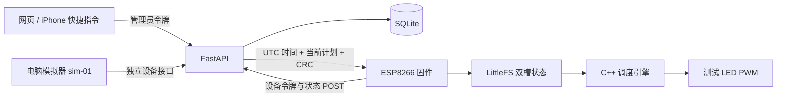

# 软件 MVP 需求、架构与执行合同

日期：2026-10-22。该文档定义现在已实现的最小软件版本；完整产品文档 v2 仍是后续目标。

## 1. 本阶段范围

现有硬件只需一块带 USB 的 ESP8266 开发板，优先使用板载 LED。先让一次唤醒计划从手机/网页到设备完整闭环，不模拟不存在的电池、RTC、温度或扬声器能力。

用户已确认使用 NodeMCU，电脑充当后台；本阶段先跑通灯光链路，新闻语音暂不实现。

| 要求 | 当前实现 |
| --- | --- |
| 设置单次起床时间 | POST 创建，最多未来七天，时间必须带时区 |
| 修改起床时间、渐亮/保持、亮度 | PATCH 提交完整计划 |
| 渐亮 | 线性 0 → 峰值，1–2700 秒 |
| 峰值保持 | 1–3600 秒，之后熄灭 |
| 取消 | DELETE 生成新版本的禁用快照 |
| 确认保存 | 设备 Flash 保存/读回验证后，下一次同步报告版本和 CRC |
| 防止重复执行 | 请求 ID 去重、版本检查、完成事件 ID 持久化 |
| 重启后台 | SQLite 保留计划版本、请求记录与设备报告 |
| 暂时断网 | 已校时、不断电的设备按缓存计划执行 |
| 设备断电后离线启动 | 保持关闭，等待重新校时，不假装知道当前时间 |
| 实物未连接时的软件验证 | 独立 simulator 身份，永不计入实物在线数 |
| iPhone | 手动创建设置/修改/取消快捷指令，步骤和请求格式已提供 |

本阶段只维护一个当前计划。新建会替换当前计划；未实现每周重复、多个重叠闹钟、贪睡、普通夜灯、新闻和电池休眠。API 对未知字段报错，不对尚未实现的能力静默返回成功。

## 2. 相对 v2 的取舍

| v2 产品目标 | MVP 选择 | 原因与后续 |
| --- | --- | --- |
| MQTT/TLS、Broker | 私有局域网 HTTP，每约 2 秒同步 | 减少初期依赖；保留协议语义，后续更换传输层 |
| DS3231 供电与离线时间 | 电脑返回 UTC 时间 + 设备毫秒计数 | 当前没有 RTC；断电后必须校时 |
| 三盏电池灯 | 一个实物身份 + 一个虚拟身份 | 先跑一灯完整链路；后续可添加设备身份 |
| 20 kHz 恒流驱动输入 | 测试 LED 的 1 kHz PWM | 当前不连接 TPS923611；未来更换驱动时调整 |
| iOS App / 完整网页栈 | Shortcuts + 无构建静态页面 | 初版无需 Node 包或原生 App |
| 云 TTS 与新闻 | 下一阶段 | 本阶段先验证按时亮灯 |

HTTP 令牌用于区分操作权限，不提供链路加密。仅在可信局域网开发，不做公网端口映射；正式网络安全升级仍需要 HTTPS/MQTT TLS。

## 3. 架构



后台无需在起床时发命令。设备提前拿到绝对时间，自己执行渐亮。后台掉线与取消尚未送达是不同情形；离线不能接收新修改。

## 4. API 与认证

管理员请求头：`Authorization: Bearer <admin_token>`。设备请求使用对应设备自己的令牌，不能用设备令牌修改闹钟，也不能用管理员令牌冒充设备确认。

| 方法/路径 | 内容 |
| --- | --- |
| `GET /health` | 无令牌的最小健康状态 |
| `GET /` | 控制页；计划和设备数据仍需认证读取 |
| `GET /api/v1/state` | 当前计划、设备最后状态、实物保存和就绪数 |
| `POST /api/v1/wake-plans` | 创建并替换当前单次计划 |
| `PATCH /api/v1/wake-plans/{id}` | 修改当前启用计划，提交所有字段 |
| `DELETE /api/v1/wake-plans/{id}` | 取消当前计划，重复取消不再次增版本 |
| `GET /api/v1/wake-plans/{id}/sync` | 查询该计划的确认；已被替换则 404 |
| `POST /api/v1/devices/{id}/sync` | 设备上报并取得最新快照 |

创建/修改返回 202 表示后台接收，不代表 LED 已保存。保存成功与在线就绪分别显示。设备 12 秒无上报显示离线，但历史保存结果仍保留。

## 5. 时间与数据合同

手机输入使用带时区的 ISO 8601；后台转换为 UTC Unix 毫秒。设备协议中所有 `_ms` 均为毫秒，`ramp_seconds` / `hold_seconds` 为秒，不混用。

设置请求：

```json
{
  "request_id": "iphone-demo-001",
  "wake_at": "2026-10-23T07:00:00+07:00",
  "ramp_seconds": 1200,
  "hold_seconds": 1200,
  "peak_percent": 100
}
```

同一个 `request_id` 与同一内容重试，返回原版本但不重新安装旧计划；同 ID 改内容返回 409。每次真的修改需生成新 ID。即使原计划已过时，再次重试也不会创建新事件。

设备回复：

```json
{
  "server_time_ms": 1792677600000,
  "snapshot_json": "<规范化后的计划 JSON 字符串>",
  "snapshot_crc32": 123456789
}
```

此处时间和 CRC 只展示字段类型，不能把占位字符串当成有效设备快照。真实 CRC 对 `snapshot_json` 的 UTF-8 字节计算，算法与 Python `zlib.crc32` 一致；它检查内容损坏，不提供身份认证。

快照字段：`schema_version`、`version`、`plan_id`、`occurrence_id`、`enabled`、`ramp_start_ms`、`wake_at_ms`、`hold_until_ms`、`peak_percent`。

设备报告必须包含 `boot_id`、`ack_version`、`ack_crc32`、`state`、`brightness`、`clock_valid`、`storage_ok`，可附 `completed_occurrence_id`、`last_error`。

## 6. 固件与持久化

`wake_engine.h` 不依赖 Arduino，电脑测试运行的就是固件使用的 C++ 函数。状态：needs_time、idle、armed、ramping、holding、done、fault。

输出规则：开始前关闭；渐亮区间线性增亮；起床到保持结束间为峰值；到结束时关闭。完成 ID 相同时，即使时间回退也不重放该事件。

LittleFS 使用两个状态槽：写入另一槽 → 关闭并重新读取 → 校验 generation、完整内容与 CRC → 才切换生效。每次记录包含快照及完成 ID；旧有效槽保留，减小写入期间掉电损坏的影响。不对每一步亮度写 Flash。

冷启动不信任已存时间。第一次成功同步后，用电脑时间建立毫秒基准；运行中的渐亮不被每次网络请求重新校时。保持供电时断网可以继续；无 RTC 的断电恢复则等待校时。

## 7. 配置与启动

`scripts.bootstrap` 生成随机管理员/设备令牌，不在页面或日志输出令牌。保留已有配置，避免重跑初始化让设备失联。`config.local.json` 和固件 `config.h` 在 `.gitignore` 中。

后台默认 8765，Windows 的 `run.ps1` 前台运行；`simulate.ps1` 是单独进程。正式 ESP8266 默认 GPIO2 active-low，支持 NodeMCU 与 D1 mini 编译环境。没有用户 Wi-Fi 凭据时不会伪造实物接入结果。

## 8. 完成标准与验证边界

软件阶段应通过：时间/输入校验、认证隔离、版本递增、幂等、取消、临时数据库重启、模拟器独立计数，以及 C++ 引擎时间边界与 CRC 测试；另做真实 HTTP 链路验证。

实物阶段还需：识别板型、配置 Wi-Fi、连接 USB 数据线、确认串口、烧录、观察真实 LED、断网保持和断电恢复。没有完成这些，就不能把“模拟器通过”写成“ESP8266 实物通过”。

后续顺序：一灯实物 → 新闻文字与电脑中文播报 → 多设备 → RTC/电池与休眠 → 正式 HTTPS/MQTT 与外壳。

## 9. 技术资料

- [ESP8266 Core 引脚与 PWM](https://arduino-esp8266.readthedocs.io/en/latest/reference.html)
- [ESP8266 LittleFS](https://arduino-esp8266.readthedocs.io/en/latest/filesystem.html)
- [ESP8266 HTTPClient 官方示例](https://github.com/esp8266/Arduino/blob/master/libraries/ESP8266HTTPClient/examples/BasicHttpClient/BasicHttpClient.ino)
- [FastAPI 测试](https://fastapi.tiangolo.com/tutorial/testing/)
- [Apple 快捷指令 API 请求](https://support.apple.com/guide/shortcuts/request-your-first-api-apd58d46713f/ios)

