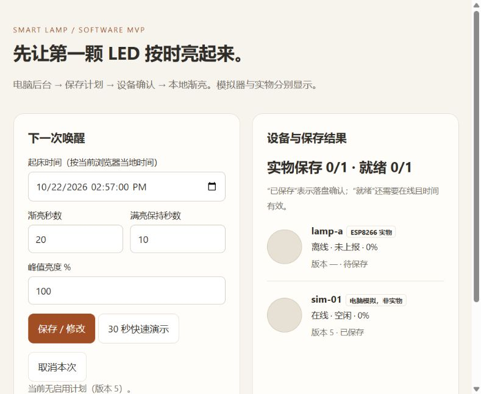

# 软件 MVP 验证记录

验证日期：2026-10-22，用户时区 Asia/Bangkok。

本次已确认目标硬件为 NodeMCU，阶段范围为电脑后台、设置时间、LED 渐亮、修改和取消。新闻语音暂不实现。

## 1. 已通过

| 项目 | 实际结果 | 证据 / 说明 |
| --- | --- | --- |
| Python 自动测试 | **24 passed** | `python -m pytest -q`，包括固件共用 C++ 引擎测试；无跳过 |
| 后台 API | 通过 | 认证边界、时区、非法输入、幂等、替换、修改、取消 |
| 持久化 | 通过软件测试 | 临时 SQLite 重启、版本不回退、旧请求不复活已取消计划 |
| 并发版本分配 | 通过 | 12 个并发请求，版本唯一递增 |
| 设备计数 | 通过 | simulator 独立于 ESP8266 实物，CRC 和持久化 ACK 必须匹配 |
| 固件调度引擎 | 在电脑编译并运行通过 | 测试的是固件使用的 `wake_engine.h`，覆盖起点、终点、完成 ID、无可信时间和 CRC |
| NodeMCU 固件 | **编译成功** | PlatformIO `espressif8266@4.2.1`、Arduino Core 3.1.2、ArduinoJson 6.21.5 |
| D1 mini 兼容环境 | 编译成功 | 兼容备选，不改变 NodeMCU 主目标 |
| 真实 HTTP 链路 | 通过 | 本机实际 HTTP 请求 + 正在运行的独立模拟器进程 |
| 浏览器控制页 | 通过界面检查 | 登录、创建快速演示、显示设备确认，观察到 60% 满亮保持 |
| 实物/模拟边界 | 明确显示 | 实物 0/1、模拟器在线已保存，没有把模拟结果冒充实物结果 |

自动测试有一条第三方 Starlette/httpx 弃用提示，不影响此次通过；固件打包工具在 Python 3.12 下有第三方转义字符 SyntaxWarning，两种环境都成功生成固件。

### 1.1 真实 HTTP 验证过程

1. POST 创建计划，等待模拟器保存确认。
2. PATCH 将峰值从 100% 改到 60%，版本递增。
3. 观察到 `armed → ramping → holding → done`。
4. 采样渐亮百分比约为 7.57、17.72、27.88、38.19、48.35、58.50，保持阶段为 60%。
5. 完成后亮度回到 0%。
6. 另建一条计划，DELETE 取消，模拟器确认新版本并处于 idle / 0%。

原始记录位于 `data/live-verification.json`；该文件是本机运行产物。复现脚本为 `scripts/verify_live.py`，它会替换当前测试计划，仅在明确进行开发演示时运行。

### 1.2 固件构建体积

本次两种板型构建结果相同：RAM 静态使用约 30,096 / 81,920 字节，Flash 程序约 336,079 / 1,044,464 字节。它只说明构建体积，不代表已测得运行时堆余量或真实 Wi-Fi 行为。

固件路径：

```text
firmware/.pio/build/nodemcuv2/firmware.bin
firmware/.pio/build/d1_mini/firmware.bin
```

## 2. 当前本机运行入口

- 电脑控制页：`http://127.0.0.1:8765`
- 初始化时检测到的局域网地址：`http://192.168.1.19:8765`；换网络/IP 后需更新配置。
- 后台绑定 `0.0.0.0:8765`；Windows 防火墙和 iPhone 网络访问尚需在实际设备上确认。
- `sim-01` 模拟器独立运行，模拟的只是 LED 状态和持久化协议。
- 当前没有启用的唤醒计划；测试后的最终计划版本为 5，取消已确认。

本次后台通过隐藏进程启动，模拟器通过可停止的前台执行会话运行。可以使用项目 `stop-demo.ps1` 停止本项目的后台/模拟器进程树；下次按 README 的两个终端步骤启动即可。

## 3. 尚未验证

| 项目 | 原因 / 下一步 |
| --- | --- |
| NodeMCU 串口与烧录 | 本次串口扫描没有发现 COM 设备；连接支持数据的 USB 线后再次检查 |
| 实物 LED 渐亮 | 未烧录或接入实际板子，不能宣称已经点亮 |
| 实际板载 LED 引脚 | 固件默认 GPIO2 active-low；根据实物确认克隆板差异 |
| 真实 Wi-Fi | `firmware/include/config.h` 中 Wi-Fi 仍是占位符，需用户本地填写 |
| LittleFS 实物掉电恢复 | 有双槽保存实现，已编译；尚未进行真实掉电试验 |
| iPhone 快捷指令真机操作 | 已提供详细步骤，尚未在用户 iPhone 上创建和触发 |
| 设备离线保持与断电重启 | 调度引擎和模拟器软件逻辑已验证；NodeMCU 实物待验证 |
| 新闻、TTS、电池、RTC、低功耗 | 当前阶段不包含，按后续阶段接入 |

实物下一步：填写 Wi-Fi → 连接 NodeMCU → 确认 COM 口 → 按 README 烧录 → 打开串口 → 点击快速演示，确认 `lamp-a` 显示在线和版本保存。

## 4. 控制页截图

截图为模拟演示完成并取消后的真实控制页面，实物未连接。


